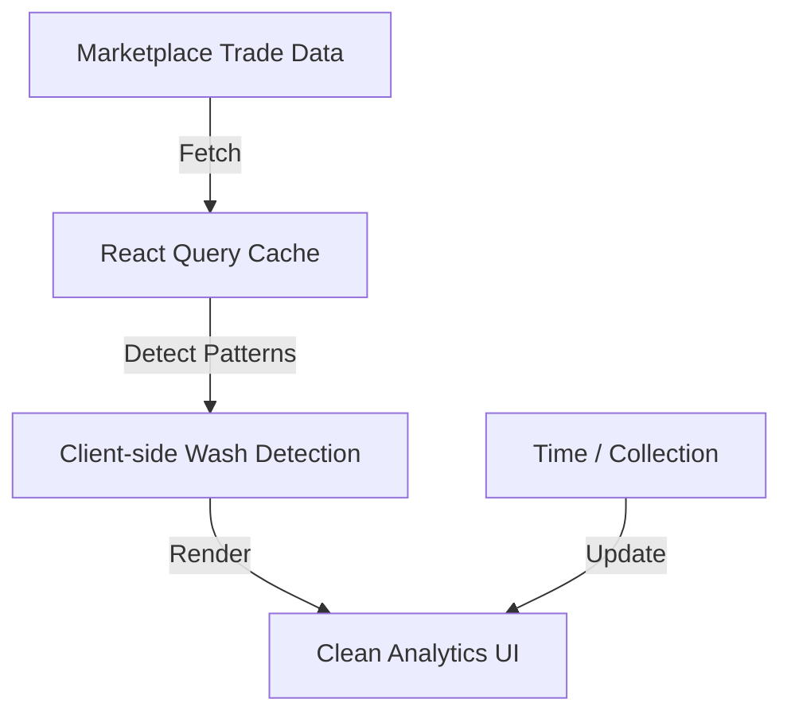

# wax-wash-trading-deduplicator — Wash Trading Detection & Clean Analytics Deduplicator

> **Status:** 🔒 Private (In Development) | Target Public Release: August 2026  
> **Category:** Marketplace & Analytics  
> **Parent Catalog:** [pixel-journey/wax-ecosystem-blueprint-catalog](https://github.com/pixel-journey/wax-ecosystem-blueprint-catalog)

**One-sentence goal:** A deduplicator and visualizer that identifies and removes wash trading patterns from marketplace activity data, providing clean, trustworthy analytics, flags, and insights for collectors, creators, and platforms on WAX.

---

## 1. Overview & Goal

This blueprint cleans marketplace data by detecting and filtering wash trading, giving users reliable insights into real activity.

- **Why it matters for WAX:** Wash trading distorts metrics and erodes trust. Clean data helps everyone make better decisions and builds ecosystem credibility.
- **Public infrastructure only:** Marketplace trade data via public APIs, client-side detection algorithms. No custom contracts.
- **Target users:** Collectors, creators, analysts, marketplace operators, anyone wanting trustworthy metrics.
- **Success metrics:** "See clean volume and activity metrics in <5s", "Clear flags for suspicious patterns", "Exportable clean datasets".

---

## 2. Concepts & Inspiration

- **Core concepts:** Wash trading often shows patterns like rapid buy/sell cycles between related wallets, unusual volume spikes without price movement, or coordinated activity. Client applies heuristics and visual flags.
- **Pain points:** Raw marketplace data includes wash trading, making metrics unreliable. Users want clean, actionable insights.
- **Inspirations:** Crypto analytics platforms with wash trading filters, traditional market surveillance tools. Web3: transparent, on-chain-aware detection.
- **Cross-references:** Perfect with other marketplace analytics (velocity scatter, royalty pie visualizer) and forensics tools (sybil detection, funding trail graph).

---

## 3. Design Specifications (Pixel Journey Standards)

### 3.1 Visual & Interaction Design
- Clean dashboard with main metrics (volume, trades) and a "clean vs raw" toggle.
- Main visual: Timeline or scatter of flagged vs clean activity with subtle highlighting.
- Sidebar: Filters for time, collection, severity of flags.
- Micro-interactions: Hover shows detailed pattern explanation, click expands suspicious clusters.
- Responsive: Excellent on desktop for analysis; mobile-friendly summary cards.

### 3.2 Key Views / Components
- `CleanAnalyticsDashboard.tsx` — Main dashboard with clean metrics and toggle.
- `WashFlagTable.tsx` — Sortable table of flagged patterns with explanations.
- `ActivityTimeline.tsx` — Visual timeline with clean vs flagged overlay.
- `PatternExplanation.tsx` — Detailed breakdown of detection logic.
- `ExportPanel.tsx` — Export clean data or flagged reports.

### 3.3 Accessibility (A11y) & Inclusive Design
- WCAG 2.2 AA: High contrast flags, keyboard navigation, screen reader descriptions of patterns.
- Data table fallback for all visualizations.
- Clear, plain-language explanations of flags.

### 3.4 Performance & Optimization Targets
- Efficient pattern detection with caching.
- Fast rendering of timelines and tables.
- Responsive design with progressive enhancement.

---

## 4. Technical Architecture

### 4.1 Core Tech Stack
- Next.js 15 + TypeScript + Tailwind + shadcn/ui + Recharts
- @tanstack/react-query
- Marketplace public trade data APIs
- Client-side detection heuristics (clustering, velocity analysis)
- date-fns for time handling

### 4.2 Data Flow Diagram


### 4.3 Folder Structure
```
app/
├── (dashboard)/page.tsx
├── components/
│   ├── analytics/
│   │   ├── CleanAnalyticsDashboard.tsx
│   │   └── WashFlagTable.tsx
│   └── timeline/
│       └── ActivityTimeline.tsx
├── hooks/useCleanAnalytics.ts
├── lib/wax/
│   ├── wash-detector.ts
│   └── data-cleaner.ts
└── types/analytics.ts
```

### 4.4 Security & Privacy
- Purely public data. No PII.
- Clear methodology for detection (transparent and auditable).

---

## 5. Implementation Examples & Code Snippets

**Core detection hook**
```ts
// hooks/useCleanAnalytics.ts
export function useCleanAnalytics(collection: string, timeRange: string) {
  return useQuery({
    queryKey: ['clean-analytics', collection, timeRange],
    queryFn: async () => {
      const trades = await fetchTrades(collection, timeRange);
      return detectAndCleanWashTrades(trades);
    }
  });
}
```

**Detection example**
```ts
function detectAndCleanWashTrades(trades: any[]) {
  // Apply heuristics: rapid cycles, related wallets, volume without price impact
  const { cleanTrades, flags } = applyWashFilters(trades);
  return { cleanTrades, flags, cleanVolume: sum(cleanTrades) };
}
```

---

## 6. Demo & Testing
- Mock data with realistic wash patterns and clean metrics.
- Live mode with real marketplace data.
- Interaction tests: filters, flag details, export.
- Detection accuracy tests with labeled examples.

---

## 7. Roadmap
Phases: Detection heuristics and data cleaning → Dashboard UI with flags and timelines → Polish, a11y, export → full documentation.

Future: Machine learning detection (optional), creator alerts, integration with other analytics tools.

---

## 8. Visual References
> Clean analytics dashboards like Dune or Glassnode with wash trading filters. Clear flags, trustworthy metrics, professional yet approachable. Reference: high-quality market surveillance visualizations.

---

## 9. Related Blueprints
- Other marketplace analytics (velocity scatter, royalty pie visualizer).
- Forensics tools (sybil detection, funding trail graph).

---

## 10. License & Credits
MIT. Built for trustworthy marketplace analytics on WAX.

**Pixel Journey — Beautiful interfaces for public blockchain data.**
